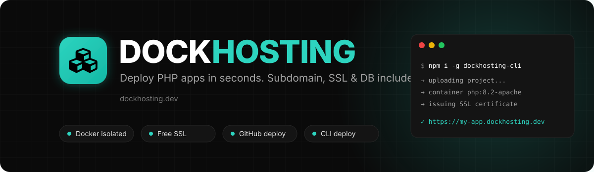
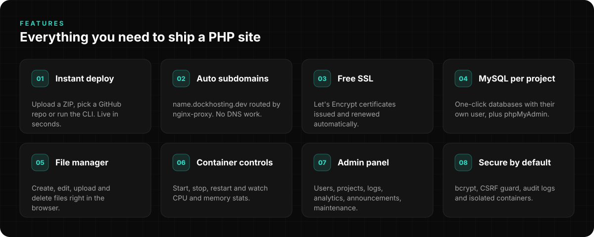
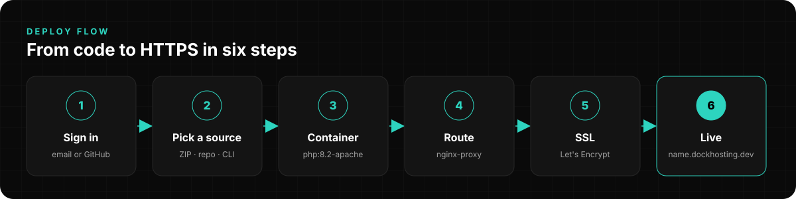
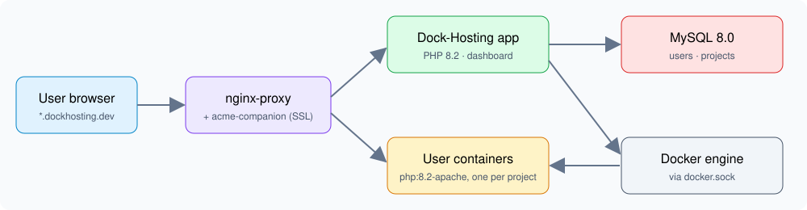
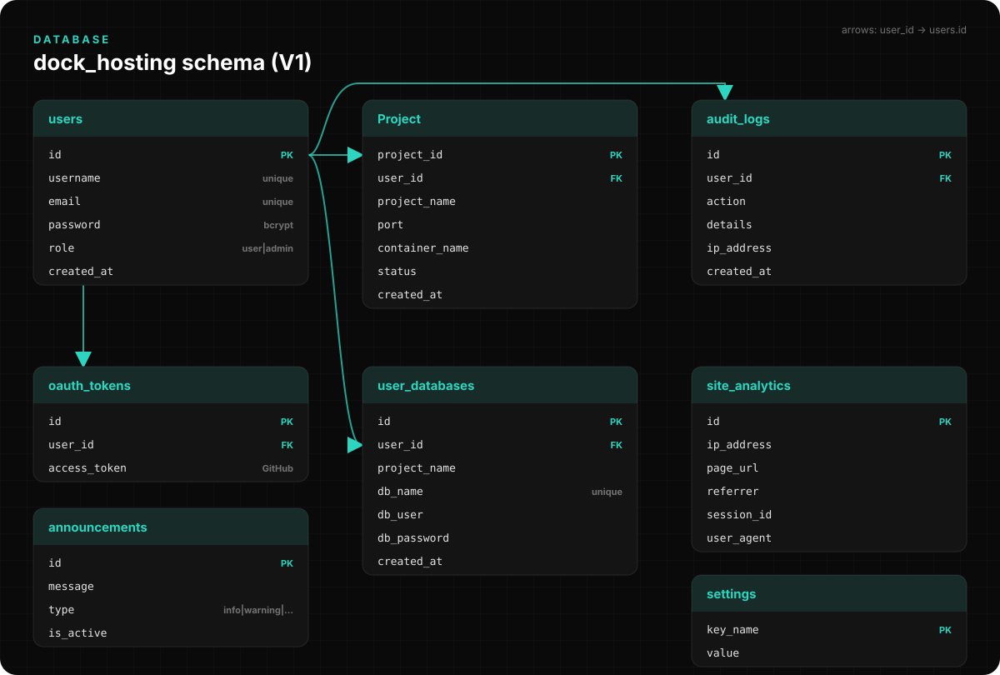

<p align="center">
  
</p>

<p align="center">
  <a href="https://www.dockhosting.dev"></a>
  
  
  
  
</p>

<p align="center">
  <b>Dock-Hosting</b> is a self-hosted PaaS that deploys PHP apps into isolated Docker containers,<br>
  with an automatic subdomain, a free SSL certificate and a MySQL database for every project.
</p>

---



## Deploy flow



You can deploy in three ways:

| Source | How |
|--------|-----|
| **ZIP upload** | Upload your project from the dashboard |
| **GitHub** | Connect your account with OAuth, then pick a repository and branch |
| **CLI** | `npm install -g dockhosting-cli`, log in, and deploy from your terminal |

## Architecture



| Service | Role |
|---------|------|
| `nginx-proxy` | Reverse proxy that routes each subdomain to its container |
| `acme-companion` | Issues and renews Let's Encrypt certificates |
| `web` | The Dock-Hosting app (PHP 8.2 + Apache). Talks to Docker through `docker.sock` |
| `db` | MySQL 8.0 for the platform and for user databases |
| `pma` | phpMyAdmin at `pma.dockhosting.dev` |
| User containers | One `php:8.2-apache` container per project |
| `cron/collect_stats.php` | Saves `docker stats` (CPU, memory, network) to the database |

## Database



The schema is in [`sql/install.sql`](sql/install.sql). MySQL loads it automatically on first start.

---

## Production setup

**You need:** an Ubuntu/Debian VPS, Docker with Docker Compose, and a domain you control.

### 1. DNS

| Type | Name | Value |
|------|------|-------|
| A | `@` | `YOUR_VPS_IP` |
| A | `www` | `YOUR_VPS_IP` |
| A | `*` | `YOUR_VPS_IP` |

The wildcard record (`*`) gives every project its own subdomain.

### 2. Install

```bash
git clone https://github.com/doughmi-ilyas/dockhosting-v1.git
cd dockhosting-v1

cp .env.example .env
nano .env            # set DB_PASSWORD, paths and LETSENCRYPT_EMAIL

sudo mkdir -p /home/deployer/dock-hosting-data/Projects

docker network create proxy_network
docker compose -f docker-compose-proxy.yml up -d   # nginx-proxy + SSL
docker compose up -d --build                       # app + MySQL + phpMyAdmin
```

### 3. Stats cron (optional)

```bash
* * * * * docker exec dock-hosting-app php /var/www/html/cron/collect_stats.php
```

### Continuous deployment

[`.github/workflows/deploy.yml`](.github/workflows/deploy.yml) connects to the VPS over SSH, pulls `main` and rebuilds the containers on every push. To turn it on, add the `VPS_HOST`, `VPS_USERNAME` and `VPS_PASSWORD` secrets to the repository.

## Local development

```bash
git clone https://github.com/doughmi-ilyas/dockhosting-v1.git
cd dockhosting-v1
cp .env.example .env
docker network create proxy_network
docker compose up -d
```

The app runs at `http://localhost` and MySQL at `localhost:3306`.

## Project structure

```
dockhosting-v1/
├── api/          CLI deploy, file manager, GitHub repos, stats endpoints
├── Classes/      Login, Signup, Project, Admin, DatabaseManager, GitHubManager
├── components/   Sidebars
├── cron/         Container stats collector
├── docs/         README images
├── includes/     Actions, auth, CSRF guard, middleware, logger
├── pages/        Dashboard, project, file manager, settings, admin panel
├── php/          Database connection
├── proxy/        Proxy compose file
├── sql/          Database schema
├── docker-compose.yml
└── docker-compose-proxy.yml
```

## Security

- Passwords hashed with bcrypt
- Cross-site POST requests blocked by an Origin check on every request
- Audit log of user and admin actions
- Each project runs in its own container
- Maintenance mode and announcements from the admin panel

## License

MIT. Free to use for learning and personal projects.

<p align="center"><sub>Built by <a href="https://github.com/doughmi-ilyas">Ilyas Doughmi</a></sub></p>
